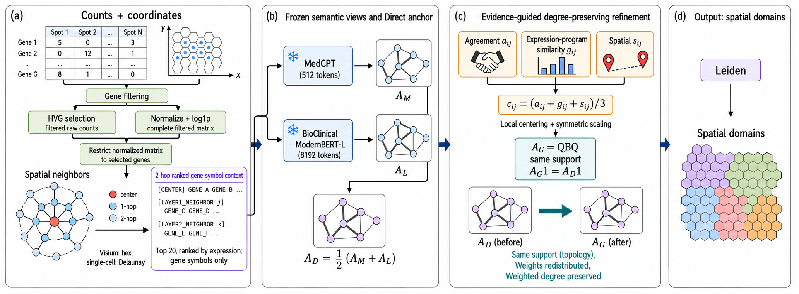

# Degree-GEAR

> **Degree-GEAR: label-free spatial domain identification that reweights a frozen-encoder affinity graph without changing its edges or node degrees.**

`Degree-GEAR` (**Degree**-preserving **G**raph **E**vidence **A**ggregation and **R**eweighting) is a Python package for spatial domain identification in spatial transcriptomics. It describes each observation's spatial neighbourhood as a short text of gene symbols, embeds these contexts with two frozen biomedical text encoders, and fuses the two embedding views into one anchor affinity graph. It then reweights the anchor's edges with label-free edge evidence while keeping every edge and every node's weighted degree, and clusters the result with Leiden. It works on `AnnData` objects and writes its results to the standard `obsm`, `obsp`, `obs` and `uns` slots.

The package provides:

- a one-call entry point, `run_degree_gear`, and four stage functions that you can also run one at a time,
- frozen dataclass configuration (`DegreeGearConfig` and one config per stage), with the defaults in `DEFAULT_DEGREE_GEAR_CONFIG`,
- pinned encoder revisions and a locked dependency set (`uv.lock`),
- a run record in `uns["degree_gear"]` that includes a check that the refined graph kept the anchor's edges and weighted degrees.

---

## Table of Contents

1. [Overview — What Degree-GEAR does](#1-overview--what-degree-gear-does)
2. [How Degree-GEAR works](#2-how-degree-gear-works)
   - [2.1 The problem it addresses](#21-the-problem-it-addresses)
   - [2.2 The pipeline step by step](#22-the-pipeline-step-by-step)
   - [2.3 Design decisions](#23-design-decisions)
3. [Quick Start](#3-quick-start)
4. [Usage in Detail](#4-usage-in-detail)
   - [4.1 Input requirements](#41-input-requirements)
   - [4.2 One-call route](#42-one-call-route)
   - [4.3 Staged route](#43-staged-route)
   - [4.4 Configuration reference](#44-configuration-reference)
   - [4.5 Encoders, cache, device and offline use](#45-encoders-cache-device-and-offline-use)
   - [4.6 Outputs](#46-outputs)
5. [Testing](#5-testing)
6. [License](#6-license)

---

## 1. Overview — What Degree-GEAR does

| Capability | What it does |
|------------|--------------|
| **Spatial gene contexts** | For every observation, writes up to 20 expressed gene symbols in descending expression order for the observation itself and for each neighbour in its first and second spatial neighbour layers (hexagonal grid or Delaunay triangulation). Expression values are not written into the text. |
| **Frozen dual biomedical text encoders** | Embeds every context with the MedCPT Article Encoder (512 tokens) and the BioClinical ModernBERT embedding model (8,192 tokens) at pinned revisions. No weights are trained. |
| **Direct anchor graph** | Builds a 15-nearest-neighbour UMAP connectivity graph for each encoder view and averages the two into the symmetric anchor graph $A_D$. |
| **Evidence-guided, degree-preserving reweighting** | Scores every anchor edge by encoder-view agreement, expression-program similarity and spatial proximity, reweights the edge by its locally centred evidence, then rescales the graph so that each node's weighted degree equals its degree in $A_D$. No edge is added or removed. |
| **Leiden domains** | Runs igraph Leiden (resolution 0.5) on the refined graph $A_G$ and writes the labels to `obs["degree_gear"]`. |

<p align="center">
  
</p>

**Overview of Degree-GEAR.** (a) Raw counts go through gene filtering, Seurat v3 highly variable gene selection on the filtered raw counts, library-size normalization and log transformation of the complete filtered matrix, and restriction to the selected genes. Up to 20 expressed selected gene symbols per observation, ranked by expression, are serialized over ordered two-hop spatial neighbourhoods (hexagonal grid when Visium `array_row`/`array_col` coordinates are present, Delaunay triangulation otherwise); expression values are not included in the contexts. (b) The frozen MedCPT (512 tokens) and BioClinical ModernBERT (labelled ModernBERT-L, 8,192 tokens) encoders produce the view-specific affinity graphs $A_M$ and $A_L$, whose equal-weight average is the Direct anchor $A_D$. (c) Encoder agreement $a_{ij}$, expression-program similarity $g_{ij}$ and spatial proximity $s_{ij}$ form the edge evidence $c_{ij}$; local centering and symmetric diagonal scaling give $A_G = QBQ$, which keeps the support of $A_D$ and restores its weighted-degree vector. (d) Leiden clustering of $A_G$ gives the spatial domains.

---

## 2. How Degree-GEAR works

### 2.1 The problem it addresses

The encoder views, the expression matrix and the spatial coordinates each say something about which observations belong together. The usual ways of combining such evidence in a graph (adding edges, rebuilding a k-nearest-neighbour graph on concatenated features, or rescaling edges freely) also change *which* pairs are connected and *how much total affinity* each node carries. Leiden's modularity objective depends on both, so a change in the resulting domains cannot be traced back to the evidence alone.

Degree-GEAR fixes both quantities. It builds the anchor graph $A_D$ once, then lets the evidence only redistribute each node's affinity among the neighbours it already has. The refined graph $A_G$ satisfies

```math
A_G = A_G^\top, \qquad A_G \geq 0, \qquad \mathrm{supp}(A_G) = \mathrm{supp}(A_D), \qquad A_G \mathbf{1} = A_D \mathbf{1}.
```

Because the weighted degrees $k_i$ are unchanged, the null-model term $k_i k_j / 2m$ of weighted modularity is the same for $A_D$ and $A_G$. The only difference Leiden sees is how each node's affinity is split among its existing neighbours.

### 2.2 The pipeline step by step

Notation: $N$ observations, $X$ the selected, normalized expression matrix with $G^\star$ genes, and $P$ the first two columns of `obsm["spatial"]`.

#### Step 1 — Label-free preprocessing (`preprocess_degree_gear`)

The input checks in [§4.1](#41-input-requirements) run first, and the spatial neighbour layers are computed on all observations before any change is made. The stage then runs, in this order:

1. `sc.pp.filter_genes(min_cells=10)`: drop genes detected in fewer than 10 observations.
2. Seurat v3 selection of 3,000 highly variable genes (`sc.pp.highly_variable_genes(flavor="seurat_v3")`) on the **filtered raw counts**. If 3,000 or fewer genes remain, all of them are kept and selection is skipped.
3. `sc.pp.normalize_total(target_sum=1e4)` on the **complete filtered-gene matrix**.
4. `sc.pp.log1p`.
5. Restrict the normalized matrix to the selected genes. This is $X$.
6. Serialize the gene contexts (Step 2).
7. Compute the expression program: randomized PCA (scikit-learn, seed 0) of $X$ to $r_X = \min(50, N-1, G^\star)$ components, then row-wise L2 normalization. This is $Z$.

No observation is removed, and no `obs` column other than `array_row`/`array_col` is read.

#### Step 2 — Context serialization

Neighbour layers come from one of two sources:

- **Hexagonal grid** (both `obs["array_row"]` and `obs["array_col"]` present): layer $l$ holds the observations at hexagonal grid distance $l$ on the Visium grid (neighbour offsets $`(0,\pm 2)`$ and $`(\pm 1,\pm 1)`$). Grid positions without an observation are skipped but still count toward the distance.
- **Delaunay triangulation** (neither column present): a Delaunay triangulation of $P$ defines adjacency, and layer $l$ holds the observations reached in $l$ breadth-first steps.

For the centre observation and for each neighbour in layers 1 and 2, the stage writes up to 20 gene symbols with positive normalized expression, highest first. Each segment starts with a marker, neighbours within a layer are ordered by observation index, and segments are joined with spaces. A neighbour with no expressed selected gene is left out. An abridged context:

```text
[CENTER] CAMK2A PLP1 VIP ENC1 ... [LAYER1_NEIGHBOR1] PLP1 RELN CAMK2A ... [LAYER1_NEIGHBOR2] SNAP25 MOBP ... [LAYER2_NEIGHBOR1] ENC1 PLP1 ...
```

The text contains gene symbols and markers only: no numbers and no annotations.

#### Step 3 — Frozen encoders (`embed_degree_gear`)

| View | Model | Encoding |
|------|-------|----------|
| $M$ | `ncbi/MedCPT-Article-Encoder` | `transformers`, truncated to 512 tokens, attention-mask mean pooling, L2 normalization |
| $L$ | `NeuML/bioclinical-modernbert-base-embeddings` | `sentence-transformers`, `max_seq_length = 8192` |

Both models run in inference mode at pinned revisions. With the default models, each view is a 768-dimensional vector per observation.

#### Step 4 — View graphs and the Direct anchor (`build_degree_gear_graph`)

For each view $`Y \in \{M, L\}`$, the stage runs PCA (`sc.pp.pca`, seed 0) with $r_Y = \min(50, N-1, \dim Y - 1)$ components, then `sc.pp.neighbors(n_neighbors=15)`, whose UMAP connectivities give $A_M$ and $A_L$. The anchor is

```math
A_D = \mathcal{C}\left(\tfrac{1}{2} A_M + \tfrac{1}{2} A_L\right),
```

where $\mathcal{C}(A)$ replaces $A$ with $(A + A^\top)/2$, sets the diagonal to zero and removes explicit zeros. Every later operation is restricted to the anchor edges $`\mathcal{E}_D = \{(i,j) : i \lt j,\ A_{D,ij} \gt 0\}`$. The anchor weighted degrees are $d^D = A_D \mathbf{1}$.

#### Step 5 — Edge evidence

For every $(i,j) \in \mathcal{E}_D$:

```math
a_{ij} = 1 - \frac{\lvert A_{M,ij} - A_{L,ij} \rvert}{\max(A_{M,ij} + A_{L,ij},\ \varepsilon)}, \qquad
g_{ij} = \mathrm{clip}(Z_i^\top Z_j,\ 0,\ 1), \qquad
s_{ij} = \exp\left(-\frac{\lVert P_i - P_j \rVert_2}{h}\right).
```

- $a_{ij}$ (encoder-view agreement) is near 1 when both views give the edge similar affinity. An edge missing from one view has affinity 0 there. $\varepsilon$ is float64 machine epsilon.
- $g_{ij}$ (expression-program similarity) is the clipped cosine of the program vectors.
- $s_{ij}$ (spatial proximity) uses $h$, the median of the positive distances from each observation to its nearest other observation ($h = 1$ if no distance is positive).

The composite evidence is $c_{ij} = (a_{ij} + g_{ij} + s_{ij}) / 3$. All four quantities lie in $[0, 1]$.

#### Step 6 — Local centering and reweighting

Each edge is compared with the affinity-weighted mean evidence around both of its endpoints:

```math
\mu_i = \frac{\sum_j A_{D,ij}\, c_{ij}}{d^D_i}, \qquad
\tilde{c}_{ij} = c_{ij} - \frac{\mu_i + \mu_j}{2}, \qquad
B_{ij} = A_{D,ij} \exp(\tau\, \tilde{c}_{ij}), \quad \tau = 1.
```

Edges with above-average evidence for their neighbourhood gain weight, and the rest lose weight. $B$ is symmetric and has the same support as $A_D$.

#### Step 7 — Symmetric diagonal scaling

$B$ no longer has the anchor's weighted degrees. A Sinkhorn-style symmetric scaling restores them:

```math
A_G = Q B Q, \qquad Q = \mathrm{diag}(q), \qquad
q \leftarrow q \odot \sqrt{\frac{d^D}{q \odot (B q)}}, \quad q^{(0)} = \mathbf{1}.
```

Iteration stops when $\max_i \lvert \hat{d}_i - d^D_i \rvert / d^D_i \leq 10^{-6}$, where $\hat{d} = q \odot (Bq)$, or after 200 updates. If the final graph misses the tolerance, the stage raises `ValueError`. It then checks that $A_G$ has exactly the support of $A_D$ and that the degree error is within tolerance, raises otherwise, and records the result in `uns["degree_gear"]["graph"]["contract"]`.

#### Step 8 — Leiden (`leiden_degree_gear`)

`sc.tl.leiden` runs on $A_G$ with `flavor="igraph"`, `resolution=0.5`, `n_iterations=2`, `random_state=0` and `directed=False`, using the edge weights. The labels go to `obs["degree_gear"]`.

### 2.3 Design decisions

| Decision | Why |
|----------|-----|
| Contexts hold gene symbols ranked by expression, with no numbers. | Text encoders read symbols as words; the rank order carries relative expression. |
| Two frozen encoders, no fine-tuning. | No labels and no training step are needed; the embeddings depend only on the pinned model revisions. |
| Different context limits (512 and 8,192 tokens). | MedCPT truncates long two-hop contexts at 512 tokens; the ModernBERT view can read up to 8,192 tokens of the same text. |
| The anchor $A_D$ is fixed before any evidence is used. | Every difference between $A_D$ and $A_G$ is a change of edge weight, so it can be attributed to the evidence. |
| Evidence is centred on each edge's two endpoints. | With $c_{ij} \in [0,1]$, $\exp(\tau c_{ij}) \geq 1$ would raise every edge, and nodes in high-evidence regions would gain affinity overall. Centering rewards an edge only relative to its neighbourhood. |
| Degrees are restored with $QBQ$, not row normalization. | Row normalization breaks symmetry and targets unit degrees; $QBQ$ keeps symmetry, non-negativity and support and targets $d^D$. |
| The stage checks support and degrees after scaling. | It raises instead of returning a graph that breaks either constraint, and stores the measured error in `uns`. |
| The spatial length scale $h$ comes from the data. | $s_{ij}$ is unchanged when all coordinates are rescaled, so pixel and micron coordinates give the same evidence. |
| Equal default weights for the two views and the three evidence terms. | Nothing is tuned to a dataset; `GraphConfig` exposes the weights if you need to change them. |
| Annotations are never read. | The method is label-free; any annotation columns in `obs` are ignored. |

---

## 3. Quick Start

### 3.1 Prerequisites

- Python 3.11 to 3.13 (3.11.9 or newer). The pinned `torch==2.8.0` has no wheels for Python 3.14.
- Linux, Windows or Apple-silicon macOS. Intel macOS is not supported, because `torch==2.8.0` has no wheels for it.
- Network access on the first real run, to download the two encoders from Hugging Face.
- A CUDA GPU is optional. With the default `device="auto"`, the encoders use CUDA when PyTorch can see a GPU and the CPU otherwise.

### 3.2 Install

```bash
pip install git+https://github.com/junghyunJJ/Degree-GEAR
```

For the pinned environment, clone the repository and use [uv](https://docs.astral.sh/uv/) (the repository includes `.python-version` and `uv.lock`):

```bash
git clone https://github.com/junghyunJJ/Degree-GEAR
cd Degree-GEAR
uv sync --locked
```

### 3.3 Offline smoke run

The example script is not part of the installed package, so run it from a clone. In a uv checkout, prefix the commands with `uv run`.

```bash
python examples/degree_gear_pipeline.py --smoke
```

This runs the full pipeline on a 9-spot synthetic grid with deterministic fake encoders (no model download) and prints a summary such as `degree_gear clusters=2 observations=9`.

### 3.4 Run on your data

```bash
python examples/degree_gear_pipeline.py --input input.h5ad --output degree_gear_result.h5ad
```

The script runs `run_degree_gear` with the default configuration and writes the result to `--output`. Check the input against [§4.1](#41-input-requirements) first.

---

## 4. Usage in Detail

### 4.1 Input requirements

An `AnnData` object with:

- raw non-negative counts in `adata.X` (dense or sparse);
- unique gene names in `adata.var_names` and unique observation names in `adata.obs_names`;
- finite two-dimensional coordinates in `adata.obsm["spatial"]`; only the first two columns are used.

Raw Visium data often repeats gene symbols; call `adata.var_names_make_unique()` first.

The neighbour layers depend on the Visium array columns in `adata.obs`:

| `adata.obs` has | Neighbour layers |
|-----------------|------------------|
| both `array_row` and `array_col` | Hexagonal Visium grid on those coordinates (must be finite) |
| neither | Delaunay triangulation of `obsm["spatial"]` |
| only one of them | `ValueError` |

Preprocessing also requires at least two observations and two genes, and `min_cells` must keep at least two genes. A degenerate layout, such as collinear coordinates, makes the triangulation fail with `ValueError`. These checks run before anything is written, so an input that fails them leaves `adata` unchanged.

Reference annotations are not used by the method.

The selected-gene matrix (at most `n_top_genes` columns) is converted to a dense array for context serialization and PCA.

### 4.2 One-call route

```python
import degree_gear as dg

result = dg.run_degree_gear(adata, inplace=False)
result.obs["degree_gear"]
```

`run_degree_gear(adata, config=DEFAULT_DEGREE_GEAR_CONFIG, *, encoders=None, inplace=True)` runs the four stages in order. With `inplace=False` it works on a copy and returns it. With the default `inplace=True` it modifies `adata` (including `adata.X`) and returns `None`. `config` must be a full `DegreeGearConfig`; `encoders` is described in [§4.5](#45-encoders-cache-device-and-offline-use).

### 4.3 Staged route

Each stage takes either the full `DegreeGearConfig` or its own stage config, and works in place by default:

| Function | `config` accepts |
|----------|------------------|
| `preprocess_degree_gear(adata, config, *, inplace=True)` | `DegreeGearConfig` or `PreprocessingConfig` |
| `embed_degree_gear(adata, config, *, encoders=None, inplace=True)` | `DegreeGearConfig` or `EmbeddingConfig` |
| `build_degree_gear_graph(adata, config, *, inplace=True)` | `DegreeGearConfig` or `GraphConfig` |
| `leiden_degree_gear(adata, config, *, inplace=True)` | `DegreeGearConfig` or `LeidenConfig` |

With `inplace=True` a stage returns `None`; with `inplace=False` it returns a modified copy. Preprocessing overwrites `adata.X` with normalized values and drops unselected genes, so copy first if you need the raw counts:

```python
import degree_gear as dg

adata = adata.copy()
dg.preprocess_degree_gear(adata)
dg.embed_degree_gear(adata)
dg.build_degree_gear_graph(adata)
dg.leiden_degree_gear(adata)
```

Staged calls let you repeat a late stage without repeating the encoders. For example, to cluster the same graph at another resolution into a new column:

```python
dg.leiden_degree_gear(adata, dg.LeidenConfig(resolution=1.0, key_added="degree_gear_r1"))
```

`uns["degree_gear"]["leiden"]` always describes the most recent Leiden call. When `preprocess_degree_gear` gets only a `PreprocessingConfig`, it writes to the default `EmbeddingConfig` key names.

### 4.4 Configuration reference

All configuration classes are frozen dataclasses. Build a new instance to change a value:

```python
import degree_gear as dg

config = dg.DegreeGearConfig(
    preprocessing=dg.PreprocessingConfig(n_top_genes=2_000),
    leiden=dg.LeidenConfig(resolution=0.8),
)
result = dg.run_degree_gear(adata, config, inplace=False)
```

**`DegreeGearConfig`** groups the stage configs. `dg.DEFAULT_DEGREE_GEAR_CONFIG` is `DegreeGearConfig()`.

| Field | Default | Description |
|-------|---------|-------------|
| `preprocessing` | `PreprocessingConfig()` | Settings for `preprocess_degree_gear` |
| `embedding` | `EmbeddingConfig()` | Settings for `embed_degree_gear` (and the context/program keys used by preprocessing) |
| `graph` | `GraphConfig()` | Settings for `build_degree_gear_graph` |
| `leiden` | `LeidenConfig()` | Settings for `leiden_degree_gear` |

**`PreprocessingConfig`**

| Field | Default | Description |
|-------|---------|-------------|
| `selector` | `"seurat_v3"` | Highly variable gene method. Only `"seurat_v3"` is accepted. |
| `min_cells` | `10` | Drop genes detected in fewer observations. Must keep at least 2 genes. |
| `n_top_genes` | `3000` | Number of Seurat v3 genes (at least 2). If it is not smaller than the number of filtered genes, all filtered genes are kept. |
| `normalize_total_target_sum` | `10000.0` | Target total per observation for `sc.pp.normalize_total`. |
| `context_layers` | `2` | Number of neighbour layers serialized in each context. |
| `context_top_genes` | `20` | Maximum gene symbols per context segment. |
| `evidence_reducer` | `"pca"` | Reducer for the expression program. Only `"pca"` is accepted. |
| `evidence_components` | `50` | Upper bound on program components; the stage uses $\min(\cdot, N-1, G^\star)$. |
| `seed` | `0` | Random state of the randomized PCA. |

**`EmbeddingConfig`**

| Field | Default | Description |
|-------|---------|-------------|
| `context_key` | `"degree_gear_context"` | `obsm` key for the contexts (written by preprocessing, read here). |
| `program_key` | `"X_degree_gear_program"` | `obsm` key where preprocessing writes $Z$. The graph stage reads `GraphConfig.program_key`. |
| `medcpt_model_id` | `"ncbi/MedCPT-Article-Encoder"` | Hugging Face model for view $M$. |
| `medcpt_model_revision` | `"d05a736da4bb84ee4057b7f7999485be6ed85465"` | Pinned MedCPT revision. |
| `modernbert_model_id` | `"NeuML/bioclinical-modernbert-base-embeddings"` | Hugging Face model for view $L$. |
| `modernbert_model_revision` | `"048ad4491de0fb4e2695bfe4705da67caf4804b8"` | Pinned ModernBERT revision. |
| `cache_dir` | `None` | Hugging Face cache directory; `None` uses the default cache. |
| `device` | `"auto"` | `"auto"` selects `"cuda"` if available, else `"cpu"`. Any other value is passed to PyTorch unchanged. |
| `medcpt_max_length` | `512` | MedCPT tokenizer truncation length. |
| `modernbert_max_length` | `8192` | `max_seq_length` of the ModernBERT sentence-transformers model. |
| `medcpt_batch_size` | `32` | MedCPT batch size. |
| `modernbert_batch_size` | `8` | ModernBERT batch size. |
| `show_progress` | `True` | Show the sentence-transformers progress bar during the ModernBERT pass. |

The model, revision, cache, device and maximum-length fields apply only when the package loads the encoders (`encoders=None`).

**`GraphConfig`**

| Field | Default | Description |
|-------|---------|-------------|
| `direct_key` | `"degree_gear_direct_connectivities"` | `obsp` key for $A_D$. |
| `gear_key` | `"degree_gear_connectivities"` | `obsp` key for $A_G$. |
| `medcpt_key` | `"X_degree_gear_medcpt"` | `obsm` key read for view $M$. |
| `modernbert_key` | `"X_degree_gear_modernbert"` | `obsm` key read for view $L$. |
| `program_key` | `"X_degree_gear_program"` | `obsm` key read for $Z$. |
| `spatial_key` | `"spatial"` | `obsm` key read for the spatial proximity evidence (first two columns). |
| `pca_components` | `50` | Upper bound on PCA components per view; the stage uses $\min(\cdot, N-1, \dim Y - 1)$. |
| `n_neighbors` | `15` | `n_neighbors` of `sc.pp.neighbors` for each view graph. |
| `seed` | `0` | Random state of `sc.pp.pca`. |
| `tau` | `1.0` | Evidence strength $\tau$ in $\exp(\tau \tilde{c}_{ij})$. Must be finite. |
| `degree_tolerance` | `1e-6` | Maximum relative weighted-degree error (positive). |
| `degree_max_steps` | `200` | Maximum number of scaling updates. |
| `direct_medcpt_weight` | `1.0` | Weight of $A_M$ in $A_D$. The two view weights are normalized to sum to 1. |
| `direct_modernbert_weight` | `1.0` | Weight of $A_L$ in $A_D$. |
| `evidence_view_agreement_weight` | `1.0` | Weight of $a_{ij}$ in $c_{ij}$. The three evidence weights are normalized to sum to 1. |
| `evidence_program_cosine_weight` | `1.0` | Weight of $g_{ij}$ in $c_{ij}$. |
| `evidence_spatial_proximity_weight` | `1.0` | Weight of $s_{ij}$ in $c_{ij}$. |

Each weight group must be finite and non-negative with a positive sum.

`embed_degree_gear` always writes `X_degree_gear_medcpt` and `X_degree_gear_modernbert`, so change `medcpt_key` and `modernbert_key` only if you write those arrays yourself. The Delaunay neighbour layers always use `obsm["spatial"]`, whatever `spatial_key` says.

**`LeidenConfig`**

| Field | Default | Description |
|-------|---------|-------------|
| `graph_key` | `"degree_gear_connectivities"` | `obsp` key of the graph to cluster. |
| `key_added` | `"degree_gear"` | `obs` column for the labels. |
| `resolution` | `0.5` | Leiden resolution (positive). |
| `seed` | `0` | `random_state` of `sc.tl.leiden`. |
| `flavor` | `"igraph"` | Leiden backend. Only `"igraph"` is accepted. |
| `n_iterations` | `2` | Number of Leiden iterations (at least 1). |
| `directed` | `False` | Must be `False`; the graph is undirected. |

### 4.5 Encoders, cache, device and offline use

**Download and cache.** The first real call downloads the pinned revisions of `ncbi/MedCPT-Article-Encoder` and `NeuML/bioclinical-modernbert-base-embeddings` into the Hugging Face cache (by default `~/.cache/huggingface/hub`).

**CPU or a custom cache.** Pass the embedding settings inside a full config:

```python
config = dg.DegreeGearConfig(embedding=dg.EmbeddingConfig(device="cpu", cache_dir="/path/to/hf-cache"))
result = dg.run_degree_gear(adata, config, inplace=False)
```

Passing an `EmbeddingConfig` on its own to `run_degree_gear` fails. `embed_degree_gear` accepts one directly.

**Allocator setting.** Importing `degree_gear` sets `PYTORCH_CUDA_ALLOC_CONF=expandable_segments:True`, but only if the variable is not already set.

**Offline use.** Once both revisions are in the cache, set `HF_HUB_OFFLINE=1` to load them without network access:

```bash
HF_HUB_OFFLINE=1 python examples/degree_gear_pipeline.py --input input.h5ad --output degree_gear_result.h5ad
```

**Your own encoders.** `run_degree_gear` and `embed_degree_gear` accept `encoders=(medcpt, modernbert)`, which bypasses model loading:

| Position | Must provide | Returns |
|----------|--------------|---------|
| `medcpt` | `generate_embeddings(texts, batch_size=...)` | One item per text, each with `.error` (falsy on success) and `.embedding` (a 1-D vector). A truthy `.error` raises `RuntimeError`. |
| `modernbert` | `encode(texts, batch_size=..., convert_to_numpy=True, show_progress_bar=...)` | An `(n_obs, dim)` array, as `SentenceTransformer.encode` does. |

`FakeMedCPT` and `FakeModernBERT` in `examples/degree_gear_pipeline.py` follow this interface. When you pass encoders, `uns["degree_gear"]["embedding"]` still records the revisions named in the config.

### 4.6 Outputs

| Slot | Key | Content |
|------|-----|---------|
| `X`, `var_names` | — | Log-normalized values for the selected genes (raw counts are replaced) |
| `obsm` | `degree_gear_context` | `(n_obs, 1)` object array of context strings |
| `obsm` | `X_degree_gear_program` | Expression program $Z$, `(n_obs, r_X)` |
| `obsm` | `X_degree_gear_medcpt` | View $M$, `(n_obs, 768)` with the default model |
| `obsm` | `X_degree_gear_modernbert` | View $L$, `(n_obs, 768)` with the default model |
| `obsp` | `degree_gear_direct_connectivities` | Direct anchor $A_D$ (sparse CSR) |
| `obsp` | `degree_gear_connectivities` | Refined graph $A_G$ (sparse CSR) |
| `obs` | `degree_gear` | Categorical cluster labels (`"0"`, `"1"`, …) for every observation |
| `uns` | `degree_gear` | Run record (below) |

`uns["degree_gear"]` contains one entry per stage. Each `config` entry is `dataclasses.asdict` of the stage config that was used.

| Key | Content |
|-----|---------|
| `provenance` | `{"method": "degree_gear", "label_free": True, "default_arm": "seurat_v3_cp10k_selected_pca50"}` |
| `preprocessing` | `config`; `embedding` (the `EmbeddingConfig` whose key names were used); `selected_genes`; `selection` (`selector`, `n_top_genes`, and `warnings` from the selector when selection ran, for example about non-integer counts); `normalization` (`"normalize_total_log1p"`); `label_free` |
| `embedding` | `config`; `model_revisions` (`medcpt`, `modernbert`); `label_free` |
| `graph` | `config`; `contract` (`support_identical`, `maximum_relative_weighted_degree_error`, `source_n_observations`, `graph_n_observations`); `provenance` (`{"method": "degree_preserving_seam", "label_free": True}`) |
| `leiden` | `config`; `n_observations`; `label_free`; `scanpy_params` (`resolution`, `random_state`, `n_iterations` as recorded by scanpy) |

The result can be saved with `result.write_h5ad(...)`.

---

## 5. Testing

From a clone synced with `uv sync --locked` (which installs the `dev` group with `pytest`):

```bash
uv run pytest
```

The 35 tests use small synthetic data and fake encoders, so they need neither a model download nor a GPU. They cover the default configuration and pinned revisions, equality of the one-call and staged routes, the preprocessing order, input validation that leaves `adata` unchanged, the support and weighted-degree contract, custom graph weights, and the hexagonal layer builder against a per-spot reference.

The offline smoke run is a quick end-to-end check:

```bash
uv run python examples/degree_gear_pipeline.py --smoke
```

---

## 6. License

MIT — see [LICENSE](./LICENSE). Copyright (c) 2026 junghyunJJ.

### References

- MedCPT: Jin Q. et al. MedCPT: Contrastive Pre-trained Transformers with large-scale PubMed search logs for zero-shot biomedical information retrieval. *Bioinformatics* 39(11), btad651 (2023). [doi:10.1093/bioinformatics/btad651](https://doi.org/10.1093/bioinformatics/btad651). Model: <https://huggingface.co/ncbi/MedCPT-Article-Encoder>
- ModernBERT: Warner B. et al. Smarter, Better, Faster, Longer: A Modern Bidirectional Encoder for Fast, Memory Efficient, and Long Context Finetuning and Inference. arXiv:2412.13663 (2024). <https://arxiv.org/abs/2412.13663>
- BioClinical ModernBERT: Sounack T. et al. BioClinical ModernBERT: A State-of-the-Art Long-Context Encoder for Biomedical and Clinical NLP. arXiv:2506.10896 (2025). <https://arxiv.org/abs/2506.10896>. Embedding model: <https://huggingface.co/NeuML/bioclinical-modernbert-base-embeddings>
- Scanpy: Wolf F.A., Angerer P., Theis F.J. SCANPY: large-scale single-cell gene expression data analysis. *Genome Biology* 19, 15 (2018). [doi:10.1186/s13059-017-1382-0](https://doi.org/10.1186/s13059-017-1382-0)
- anndata: Virshup I. et al. anndata: Access and store annotated data matrices. *Journal of Open Source Software* 9(101), 4371 (2024). [doi:10.21105/joss.04371](https://doi.org/10.21105/joss.04371)
- Seurat v3 highly variable genes: Stuart T. et al. Comprehensive Integration of Single-Cell Data. *Cell* 177(7), 1888–1902 (2019). [doi:10.1016/j.cell.2019.05.031](https://doi.org/10.1016/j.cell.2019.05.031). As implemented in [`scanpy.pp.highly_variable_genes`](https://scanpy.readthedocs.io/en/stable/generated/scanpy.pp.highly_variable_genes.html) (`flavor="seurat_v3"`, which uses [scikit-misc](https://github.com/has2k1/scikit-misc))
- Leiden: Traag V.A., Waltman L., van Eck N.J. From Louvain to Leiden: guaranteeing well-connected communities. *Scientific Reports* 9, 5233 (2019). [doi:10.1038/s41598-019-41695-z](https://doi.org/10.1038/s41598-019-41695-z)
- igraph (Leiden backend): <https://python.igraph.org>
- UMAP connectivities (used by `scanpy.pp.neighbors`): McInnes L., Healy J., Melville J. UMAP: Uniform Manifold Approximation and Projection for Dimension Reduction. arXiv:1802.03426 (2018). <https://arxiv.org/abs/1802.03426>
- SciPy (Delaunay triangulation): Virtanen P. et al. SciPy 1.0: fundamental algorithms for scientific computing in Python. *Nature Methods* 17, 261–272 (2020). [doi:10.1038/s41592-019-0686-2](https://doi.org/10.1038/s41592-019-0686-2). [`scipy.spatial.Delaunay`](https://docs.scipy.org/doc/scipy/reference/generated/scipy.spatial.Delaunay.html)
- scikit-learn (randomized PCA, nearest neighbours): <https://scikit-learn.org>
- Hugging Face Transformers: <https://github.com/huggingface/transformers>
- Sentence Transformers: <https://www.sbert.net>
- PyTorch: <https://pytorch.org>
